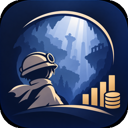
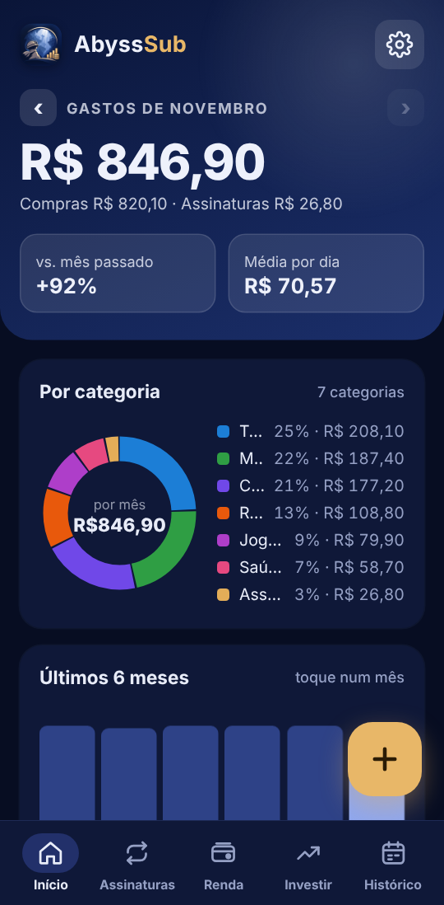
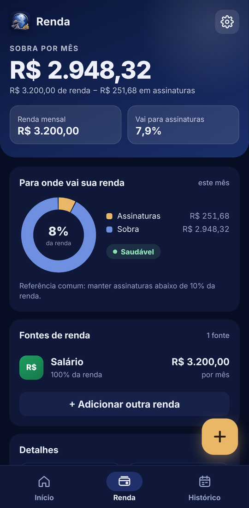
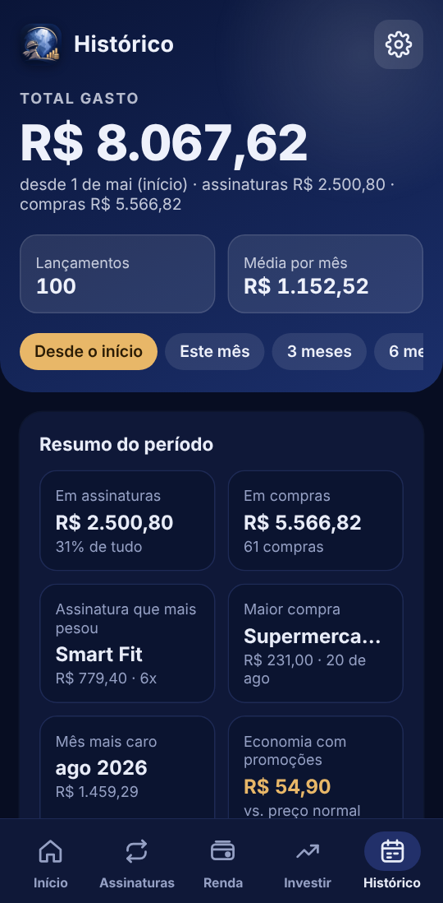
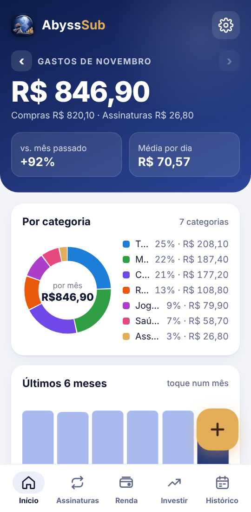
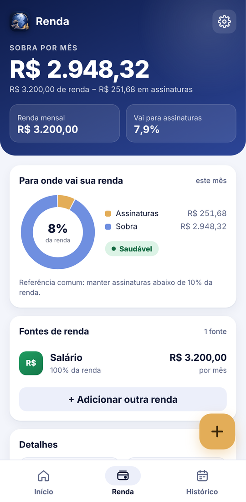
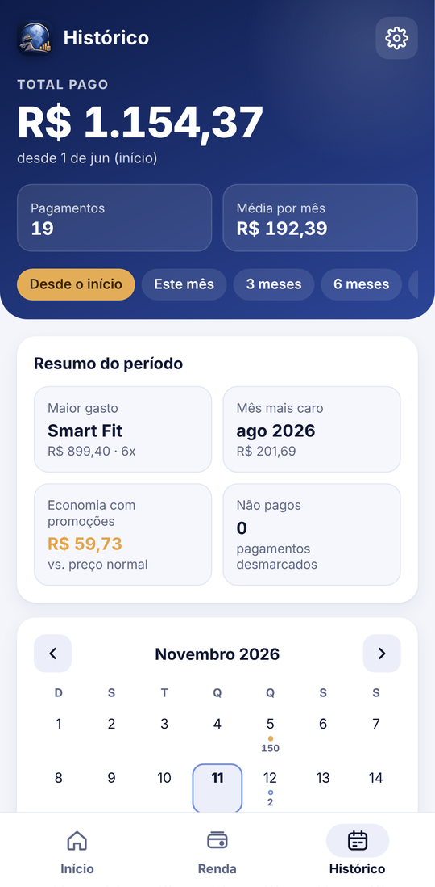

<p align="center">
  
</p>

<h1 align="center">AbyssSub</h1>

<p align="center">
  App Android para saber quanto você gasta por mês com assinaturas — e quanto sobra da sua renda.
</p>

<p align="center">
  
  
  
</p>

## Recursos

**Início**
- Total gasto por mês, por ano e nos próximos 30 dias
- Planos semanais, mensais, trimestrais, semestrais e anuais (tudo convertido para o valor mensal)
- Promoções com duração em meses — o app volta ao preço normal sozinho quando ela acaba
- Próximas cobranças com a parte mensal dos planos longos (ex.: `R$ 49,99 · 10/12`)
- Gráfico por categoria e projeção dos próximos 12 meses (toque num mês para ver os detalhes)

**Renda**
- Várias fontes de renda (mensal, quinzenal, semanal ou anual)
- Quanto sobra por mês, por dia e em 12 meses
- Quanto da renda vai para assinaturas, com indicador (Saudável / Atenção / Alto)
- Quantas horas de trabalho cada assinatura custa

**Histórico**
- Registro dos pagamentos automático ou manual (configurável)
- Calendário com pagos, previstos, a confirmar e não pagos
- Filtros de período: desde o início, este mês, 3 meses, 6 meses, este ano ou período personalizado
- Resumo: maior gasto, mês mais caro, economia com promoções
- Gráfico por mês, ranking por assinatura e extrato

**Conta e nuvem**
- Na primeira abertura: **Entrar com Google**, **Entrar com e-mail** ou **Continuar sem conta** (também em Configurações > Conta)
- Com a conta Google, tudo é salvo no Firebase e volta sozinho em qualquer celular
- Funciona sem internet e sincroniza quando a conexão voltar
- Backup em texto (Configurações > Backup) para guardar ou passar para outro celular
- Sem conta, os dados ficam só no celular

**Encontrar assinaturas automaticamente**
- Catálogo com mais de 50 serviços populares para cadastrar com um toque
- Importa extratos do banco (OFX ou CSV), vários de uma vez ou um mês por vez, e encontra as assinaturas que você já paga
- Foto em cada assinatura: ícone do serviço, foto da galeria ou letra colorida
- Lê as notificações de compra dos apps de banco (opcional) e sugere novas assinaturas
- Tudo é analisado no celular; nada é cadastrado sem você confirmar

**Lembretes e segurança**
- Notificação antes de cada cobrança (no dia, 1, 2, 3 ou 7 dias antes, no horário que você escolher)
- Bloqueio ao abrir: senha do app, bloqueio do celular ou digital

**Geral**
- Tema claro, escuro ou automático (segue o celular)
- Animações em toda a interface
- Avisa quando sai uma versão nova no GitHub e atualiza direto pelo app (baixa e abre o instalador)

<details>
<summary>Ver no modo claro</summary>
<p align="center">
  
  
  
</p>
</details>

## Baixar

Baixe o `AbyssSub.apk` mais recente na página de **[Releases](../../releases)**, abra no celular e permita
"instalar apps desconhecidos" quando o Android pedir. Requer Android 7.0 ou superior.

> Se o segredo `ABYSS_DEBUG_KEYSTORE` não estiver configurado, o APK do GitHub sai com outra assinatura:
> aí é preciso desinstalar antes de trocar de um APK para o outro.

## Compilar

**Android Studio**
1. `File > Open` e selecione a pasta do projeto
2. Aguarde o *Gradle sync*
3. `Build > Generate App Bundles or APKs > Generate APKs`
4. O APK é copiado para a pasta `APK/`

**Linha de comando**
```bash
./gradlew assembleDebug        # Linux/macOS
gradlew.bat assembleDebug      # Windows (ou dê dois cliques em gerar-apk.bat)
```

Requisitos: JDK 17+ e Android SDK (o Android Studio já instala os dois).

**Login com Google:** precisa de um projeto no Firebase e do arquivo `app/google-services.json`.
Veja o passo a passo em **[CONFIGURAR-FIREBASE.md](CONFIGURAR-FIREBASE.md)**. Sem esse arquivo o app
compila do mesmo jeito e funciona só no modo sem conta.

**GitHub Actions** — todo push na `main` gera o APK automaticamente (aba *Actions > Artifacts*).
Para o APK do GitHub ter a mesma assinatura do seu PC (necessário para o login), crie o segredo
`ABYSS_DEBUG_KEYSTORE` com o `chave-github.bat` (detalhes no guia do Firebase).
Para publicar uma versão: no site, **Releases > Draft a new release**, crie a tag (ex.: `v1.6.1`) e publique.
O workflow roda sozinho e anexa o `AbyssSub.apk` na Release em alguns minutos.
O texto que você escrever na descrição da Release aparece no aviso de atualização dentro do app.
Use tags no formato `v1.7`, `v1.7.1`… e aumente o `versionName`/`versionCode` em `app/build.gradle` antes.

## Estrutura

```
app/src/main/
├── assets/index.html          # toda a interface e a lógica do app
├── java/.../MainActivity.java # abre a interface (WebView), login com Google e sincronização (Firebase)
├── res/                       # ícones, nome do app e temas claro/escuro
└── AndroidManifest.xml
```

`firestore.rules` tem as regras de segurança do banco (cada pessoa só acessa os próprios dados).

A interface pode ser testada direto no navegador do computador abrindo `app/src/main/assets/index.html`.

## Histórico de mudanças

Veja o que mudou em cada versão em **[CHANGELOG.md](CHANGELOG.md)**.

## Licença

[MIT](LICENSE)
