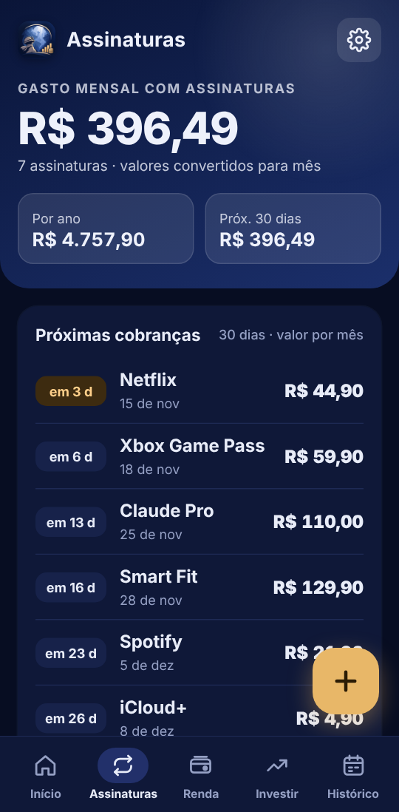
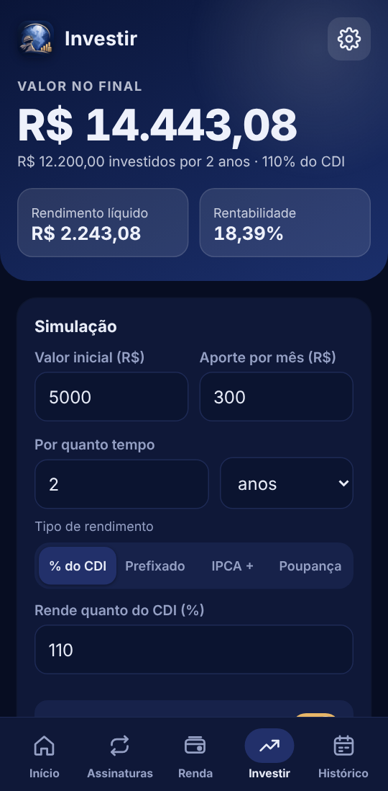
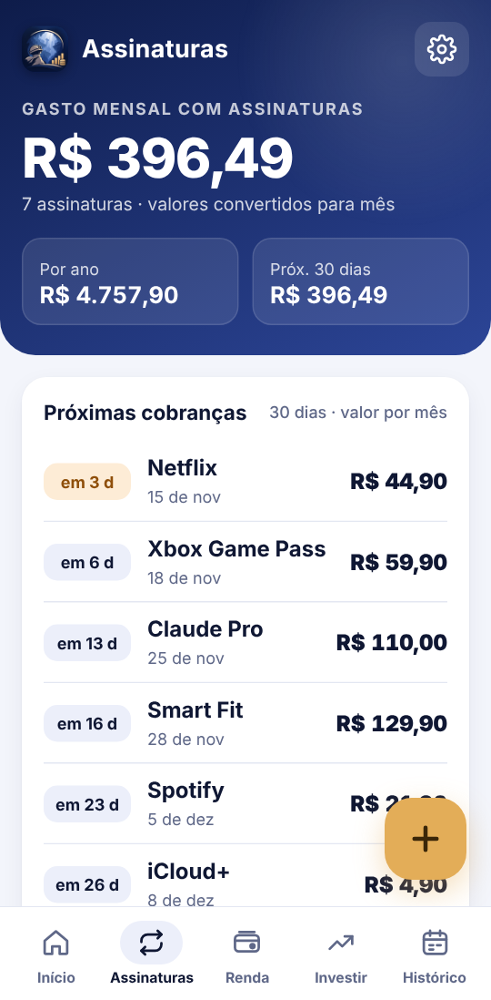
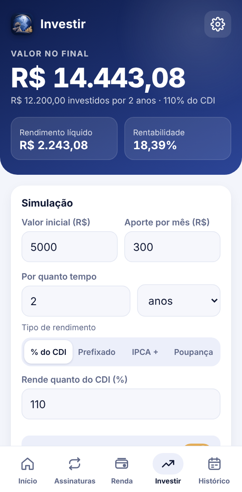

<p align="center">
  
</p>

<h1 align="center">AbyssSub</h1>

<p align="center">
  App Android para controlar <b>todos os seus gastos</b>: assinaturas, compras do dia a dia, quanto sobra da renda
  e quanto o seu dinheiro pode render investido.
</p>

<p align="center">
  <a href="../../releases/latest"></a>
  
  <a href="LICENSE"></a>
</p>

<p align="center">
  
  
  
  
  
</p>

<details>
<summary><b>Ver no modo claro</b></summary>
<p align="center">
  
  
  
  
  
</p>
</details>

## Sumário

- [Recursos](#recursos)
- [Privacidade](#privacidade)
- [Baixar e instalar](#baixar-e-instalar)
- [Compilar](#compilar)
- [Login e sincronização (Firebase)](#login-e-sincronização-firebase)
- [Publicar uma versão](#publicar-uma-versão)
- [Estrutura do projeto](#estrutura-do-projeto)
- [Histórico de mudanças](#histórico-de-mudanças)

## Recursos

O app tem cinco abas: **Início · Assinaturas · Renda · Investir · Histórico**.

### Início: todos os gastos

- Total gasto no mês (compras + assinaturas), com setas para navegar entre os meses
- Comparação com o mês passado (até o mesmo dia) e média por dia
- Gráfico por categoria, barras dos últimos 6 meses (toque numa barra para ver os detalhes) e destaques do mês:
  maior gasto, onde mais gastou, dia da semana que mais gasta, dias sem gastar e mais
- **Onde você mais gasta**: ranking alternando entre *Tudo*, *Só gastos* e *Só assinaturas*
- Lista por dia com busca e filtro por categoria
- Categorias automáticas: mercado, restaurantes e delivery, transporte, saúde, compras, contas,
  **jogos**, lazer e viagem, educação, pets, beleza, apps, Pix e outros
- **Lista de lojas e apps** (Steam, Roblox, PlayStation, iFood, Uber, Mercado Livre, Shopee, Amazon…)
  com ícone de cada um, e **foto personalizada** para qualquer lugar
- **Juntar nomes diferentes que são o mesmo lugar** (ex.: "Pagseguro International" é a Steam), com opção de separar depois
- Uma compra pode virar assinatura: ela mesma passa a ser o primeiro pagamento, sem duplicar o gasto
- Compras vêm sozinhas do extrato e das notificações do banco, ou são adicionadas à mão

### Assinaturas

- Gasto por mês, por ano e nos próximos 30 dias
- Planos semanais, mensais, trimestrais, semestrais e anuais (tudo convertido para o valor mensal)
- Promoções com duração em meses: o app volta ao preço normal sozinho quando ela acaba
- Próximas cobranças, com a parte mensal dos planos longos (ex.: `R$ 49,99 · 10/12`)
- Gráfico por categoria e projeção dos próximos 12 meses
- Catálogo com mais de 80 serviços (streaming, música, IA, jogos, academia, nuvem, celular, VPN, notícias…) para cadastrar com um toque
- Foto em cada assinatura: ícone do serviço, foto da galeria ou letra colorida
- **Outros nomes**: cobranças que aparecem com outro nome no extrato contam como a mesma assinatura
  (ao renomear, o nome antigo continua valendo)
- **Juntar duas assinaturas** que são a mesma: o histórico passa para uma só

### Renda

- Várias fontes de renda (mensal, quinzenal, semanal ou anual)
- **Sobra de cada mês**, com navegação entre os meses
- Três modos: *Tudo* (padrão: assinaturas + gastos), *Só assinaturas* ou *Só gastos*
- Gráfico de para onde vai a renda: assinaturas, gastos e sobra
- Quanto da renda vai para assinaturas, comparado com a sua referência (5%, 10%, 15%, 20%, 30% ou um valor seu)
- Sobra por dia e em 12 meses, valor da sua hora e quantas horas de trabalho cada assinatura custa

### Investir: simulador

- Valor inicial, aporte mensal e prazo em **dias, meses ou anos**
- Rendimento em **% do CDI**, **prefixado**, **IPCA + taxa** ou **poupança**
- Imposto de Renda pela tabela regressiva e IOF nos primeiros 30 dias (dá para desligar para LCI/LCA e outros isentos)
- Resultado: valor final líquido, rendimento bruto e líquido, imposto, taxa equivalente ao ano e ao mês,
  ganho acima da inflação, quanto rende por mês no fim e em quanto tempo o dinheiro dobra
- Gráfico da evolução e comparação no mesmo prazo com poupança, 100% do CDI, LCI 90%, Tesouro IPCA+ e dinheiro parado
- Taxas (Selic, CDI, IPCA e TR) editáveis e simulações salvas

> As simulações são estimativas com as taxas informadas, que podem mudar durante o prazo.
> Não são recomendação de investimento.

### Histórico

- Total gasto com tudo no período, separando assinaturas e compras (inclusive cobranças antigas achadas no extrato)
- Períodos: desde o início, este mês, 3 meses, 6 meses, este ano ou personalizado
- Calendário com pagos, previstos, a confirmar e não pagos
- Resumo: assinatura que mais pesou, maior compra, mês mais caro, economia com promoções
- Gráfico por mês, ranking por assinatura e extrato completo
- Registro dos pagamentos automático ou manual (você confirma cada um); dá para remover ou marcar como não pago

### Encontrar gastos e assinaturas automaticamente

- **Extratos do banco** em OFX ou CSV: vários arquivos de uma vez ou um mês por vez; as colunas são reconhecidas sozinhas
- **Notificações dos apps de banco** (opcional, com permissão do Android): cada compra entra nos gastos
- Assinaturas que você já paga aparecem como sugestão; nada é cadastrado sem você confirmar
- Ficam de fora o que não é gasto novo: pagamento da fatura do cartão, dinheiro guardado (Caixinha, RDB, CDB, poupança…),
  resgates, estornos e reembolsos
- "Não é um gasto (ignorar sempre)" para esconder um lugar de vez; a lista de ignorados fica em Configurações

### Conta, lembretes e segurança

- Entrar com **Google** ou **e-mail e senha**, ou usar **sem conta**
- Com conta, tudo é salvo na nuvem (Firebase) e aparece em qualquer celular; funciona sem internet e sincroniza depois
- Backup em texto para guardar ou passar para outro celular
- Notificação antes de cada cobrança (no dia, 1, 2, 3 ou 7 dias antes, no horário que você escolher)
- Bloqueio ao abrir: senha do app, bloqueio do celular ou digital
- Tema claro, escuro ou automático, com animações em toda a interface
- **Atualização pelo próprio app**: avisa quando sai uma versão nova aqui no GitHub, mostra o que mudou, baixa e abre o instalador

## Privacidade

- Extratos e notificações são lidos **só no celular**; nada disso é enviado para servidor nenhum
- Sem conta, os dados ficam apenas no aparelho
- Com conta, os dados vão para o seu espaço no Firebase, e as regras do banco garantem que só você consegue ler e gravar

## Baixar e instalar

1. Baixe o `AbyssSub.apk` mais recente na página de **[Releases](../../releases/latest)**
2. Abra o arquivo no celular e permita "instalar apps desconhecidos" quando o Android pedir
3. Para as próximas versões, o próprio app avisa e atualiza

Requer **Android 7.0** ou superior. Instalar uma versão nova por cima mantém todos os dados.

## Compilar

**Requisitos:** JDK 17+ e Android SDK (o Android Studio já instala os dois).

**Android Studio**
1. `File > Open` e selecione a pasta do projeto
2. Aguarde o *Gradle sync*
3. `Build > Generate App Bundles or APKs > Generate APKs`
4. No Windows, o APK é copiado para a pasta `APK/`

**Linha de comando**
```bash
./gradlew assembleDebug        # Linux/macOS
gradlew.bat assembleDebug      # Windows
```

**GitHub Actions:** todo push na `main` gera o APK automaticamente (aba *Actions > Artifacts*).

A interface também pode ser testada no navegador do computador abrindo `app/src/main/assets/index.html`.

## Login e sincronização (Firebase)

Sem o arquivo `app/google-services.json` o app compila do mesmo jeito e funciona no modo sem conta.
Para o login funcionar num fork:

<details>
<summary><b>Passo a passo</b></summary>

1. Crie um projeto em <https://console.firebase.google.com>
2. **Authentication > Método de login**: ative **Google** e **E-mail/senha**
3. **Firestore Database**: crie o banco (modo de produção) e, na aba **Regras**, publique:
   ```
   rules_version = '2';
   service cloud.firestore {
     match /databases/{database}/documents {
       match /users/{uid} {
         allow read, write: if request.auth != null && request.auth.uid == uid;
       }
     }
   }
   ```
4. Pegue o SHA-1 da sua chave de assinatura: no Android Studio, painel **Gradle > Execute Gradle Task** → `signingReport`
5. **Configurações do projeto > Seus apps > Android**: pacote `com.abysssub.app` + o SHA-1 → baixe o
   `google-services.json` e coloque em `app/`
6. Para o APK do GitHub Actions ter a mesma assinatura (e o login funcionar nele), crie o segredo
   `ABYSS_DEBUG_KEYSTORE` em **Settings > Secrets and variables > Actions** com a sua chave em Base64.
   No Windows (PowerShell):
   ```powershell
   [Convert]::ToBase64String([IO.File]::ReadAllBytes("$env:USERPROFILE\.android\debug.keystore")) | Set-Clipboard
   ```
   Sem esse segredo o APK do GitHub sai com outra assinatura: aí é preciso desinstalar antes de trocar de um APK para o outro.

</details>

## Publicar uma versão

1. Aumente `versionCode` e `versionName` em `app/build.gradle` e adicione a versão no [CHANGELOG.md](CHANGELOG.md)
2. Faça o push para a `main`
3. No site: **Releases > Draft a new release**, crie a tag no formato `v2.3`, `v2.3.1`… e publique
4. O workflow compila e anexa o `AbyssSub.apk` na Release em alguns minutos

O texto da descrição da Release aparece no aviso de atualização dentro do app.

## Estrutura do projeto

```
app/src/main/
├── assets/index.html            # toda a interface e a lógica do app (HTML, CSS e JavaScript)
├── java/com/abysssub/app/
│   ├── MainActivity.java        # abre a interface (WebView): login, nuvem, bloqueio, arquivos e atualização
│   ├── PurchaseListener.java    # lê as notificações de compra dos apps de banco (opcional)
│   ├── Reminders.java           # agenda os lembretes de cobrança
│   └── ReminderReceiver.java    # mostra o lembrete e reagenda depois de reiniciar o celular
├── res/                         # ícones, nome do app e temas claro/escuro
└── AndroidManifest.xml
.github/workflows/build-apk.yml  # gera o APK em todo push e anexa nas Releases
```

**Feito com:** Java + WebView, Firebase Authentication e Cloud Firestore, AndroidX Biometric e Credential Manager.

## Histórico de mudanças

O que mudou em cada versão está no **[CHANGELOG.md](CHANGELOG.md)**.

## Licença

[MIT](LICENSE)
